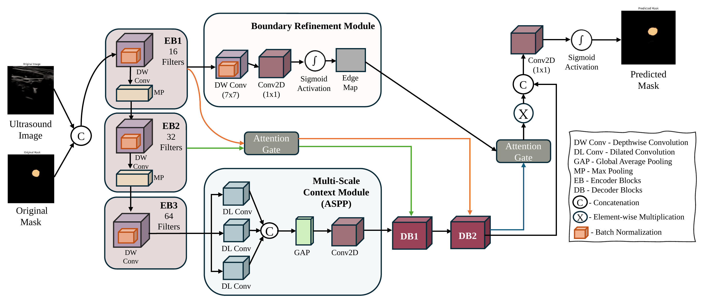
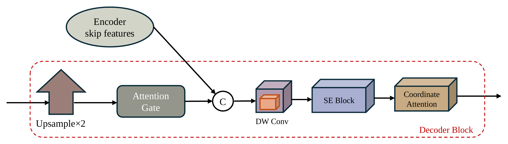
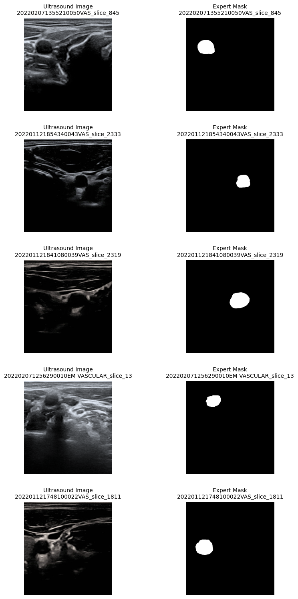
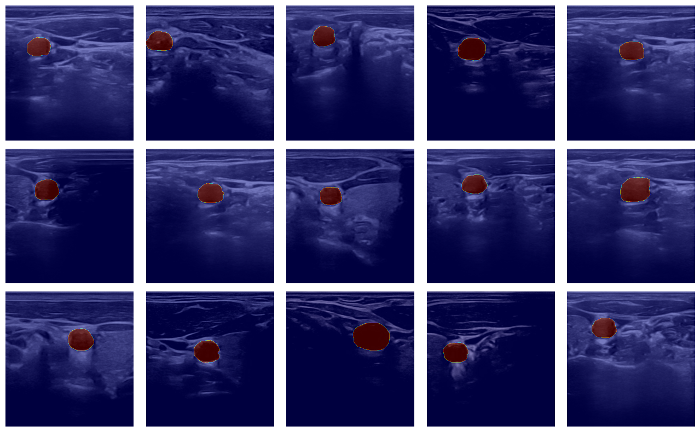

# Carotid Ultrasound Segmentation

**A lightweight attention network that segments the common carotid artery in ultrasound images.**

[](https://github.com/RashiChauhan67/carotid-ultrasound-segmentation/actions/workflows/ci.yml)
[](LICENSE)


[Overview](#overview) · [Architecture](#architecture) · [Quick start](#quick-start) · [Dataset](#dataset) · [Status](#status) · [Notes](#notes)

## Overview

The network takes a 256 x 256 ultrasound image and predicts a binary mask of the artery cross-section. It combines a depthwise-separable encoder, an ASPP-like multi-scale context module, attention gates on the skip connections, squeeze-and-excitation, coordinate attention, and a boundary-refinement branch whose edge map is fed back into the decoder.

This repository has a cleaned, tested Keras 3 implementation of the model and a leakage-free training pipeline, plus the original experiment notebook.

| | |
|---|---|
| Task | binary segmentation (artery mask) |
| Input | 256 x 256 x 3 |
| Model | 171,653 parameters (169,887 trainable) |
| Loss | binary cross-entropy + Dice |
| Metrics | Dice, IoU, precision, recall, F1, specificity |
| Dataset | 1,100 ultrasound image / expert-mask pairs |
| Trained results | **none recorded** (see [Status](#status)) |

## Architecture



Decoder block:



## Quick start

```bash
git clone https://github.com/RashiChauhan67/carotid-ultrasound-segmentation.git
cd carotid-ultrasound-segmentation
python -m venv .venv && source .venv/bin/activate
pip install -e .
```

Train, evaluate and predict:

```bash
# Train (up to 100 epochs, batch size 8, Adam 1e-4, early stopping on validation Dice)
python scripts/train.py --data-dir /path/to/carotid-ultrasound-images --output-dir runs/default

# Evaluate a saved model on the regenerated validation split
python scripts/evaluate.py --data-dir /path/to/carotid-ultrasound-images \
    --model runs/default/best_model.keras

# Segment new images; saves masks and overlays
python scripts/predict.py --model runs/default/best_model.keras --images path/to/images
```

Training writes `best_model.keras`, `training_log.csv`, `config.json`, `split.json` (the exact train/validation files) and `validation_metrics.json`.

Use the model directly:

```python
from carotid_seg.model import build_model
from carotid_seg.training import compile_model

model = compile_model(build_model())  # 171,653 parameters; trained as a mask-only model
```

## Dataset

Common carotid artery ultrasound images with expert masks: 1,100 image / mask pairs (`US images/` and `Expert mask images/`, matched by file name). Data is not included; see [`data/README.md`](data/README.md).



Mask overlays on ultrasound images:



## Status

**No trained results are included.** The original notebook defines and summarises the model, but its saved output contains no training log or evaluation numbers. As written (a two-output model compiled with one loss and fitted on one target array) it fails to train in Keras 3. This repository therefore reports no accuracy figures. Train it on the dataset and report your own numbers; the validation Dice and IoU are written to `validation_metrics.json`.

## Notes

**What the port changes from the notebook.** The model itself is unchanged: the parameter counts (171,653 total, 169,887 trainable, 1,766 non-trainable) match the notebook's `model.summary()` exactly, and a test checks them. The pipeline differs in these ways:

- **No leakage between train and validation.** The notebook shuffled the dataset and then took the first 80% as training data, but `tf.data` reshuffles every epoch, so validation images could end up in training. Here the split is made once, before anything else, and `split.json` records it.
- **Split by scan.** File names are `<scan>_slice_<n>.png`, so many slices come from one scan. By default whole scans are kept on one side of the split (`--no-group-by-scan` turns this off).
- **Validation data is not augmented.** The notebook augmented validation images as well as training images.
- **A trainable setup.** The notebook compiled a two-output model with a single loss and a single target, which Keras 3 rejects. Here training uses a mask-only view of the same network (the edge branch stays in the graph because it feeds the decoder).
- **Metrics.** The notebook's `hausdorff_distance` was a maximum absolute difference between flattened masks, not a Hausdorff distance, so it is not included. Overlap metrics are computed directly from thresholded predictions.
- The notebook's `RandomCrop(256, 256)` is the full image size, so it changes nothing; here it follows the configured size.

**Other.**
- Only the carotid cross-section is segmented; masks are single blobs, so metrics like Dice are dominated by that blob and say little about the background.
- Research code only; not validated for clinical use.
- Images are read as RGB, resized to 256 x 256 and scaled to [0, 1]; masks use nearest-neighbour resizing.

## Repository structure

```
.
├── src/carotid_seg/     # model, losses, data, training, evaluation
├── scripts/             # train.py, evaluate.py, predict.py
├── tests/               # unit tests (synthetic data; no dataset needed)
├── notebooks/           # original experiment notebook
├── docs/figures/        # architecture figures
├── results/figures/     # dataset figures from the notebook
└── data/README.md       # dataset instructions
```

Development: `pip install -e ".[dev]"`, then `ruff check .` and `pytest`.

## License

MIT. See [LICENSE](LICENSE). The dataset has its own license; check it before reuse.
